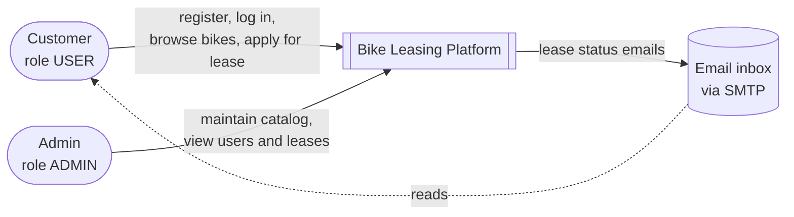
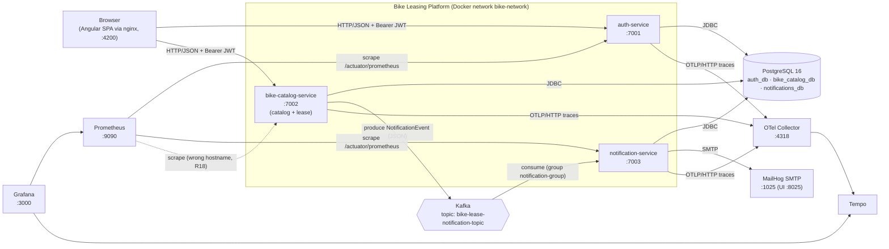
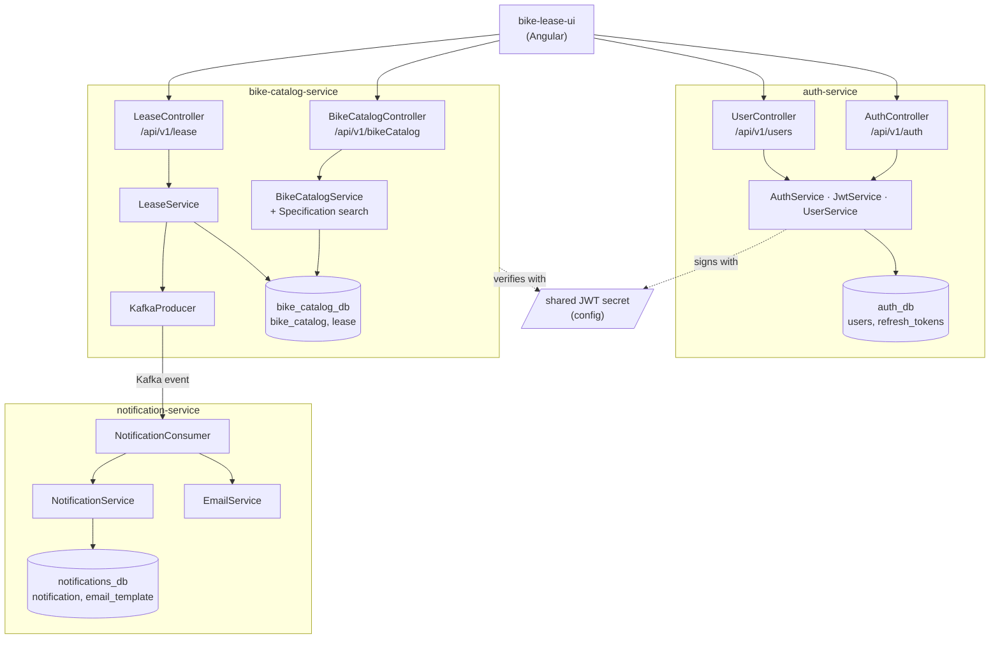
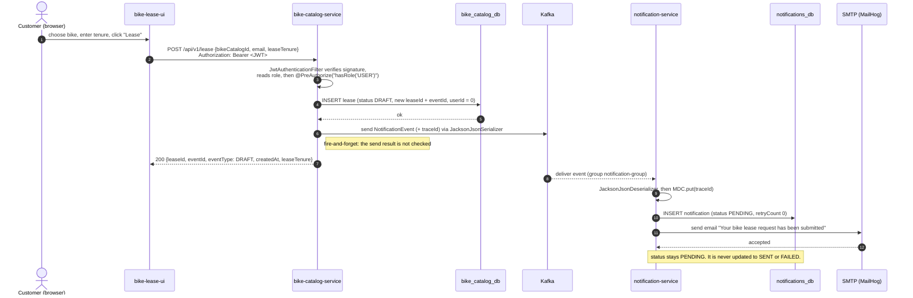
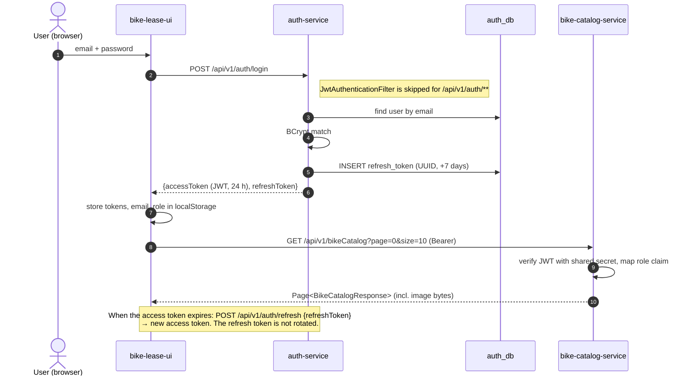

# Bike Leasing Platform — Architecture Documentation (arc42, condensed)

| | |
|---|---|
| **Repository** | `github.com/CkanthG/Leasing` |
| **Describes** | Branch `develop` as of 6 Nov 2026 |
| **Last updated** | 6 Nov 2026 |
| **Status** | Living document (DRAFT). |

This document follows a reduced arc42 structure with six sections: introduction and goals, constraints, context, building blocks, runtime view and risks/technical debt.

---

## 1. Introduction and Goals

### 1.1 What the system does

The Bike Leasing Platform lets a company publish a catalog of motorbikes that customers can lease and lets customers apply for a lease online.

Functionally, the current code supports:

- **Accounts and login.** Users register with email, password and a role (`USER` or `ADMIN`), log in, receive a JWT access token (24 h) and a refresh token (7 days) and can refresh the access token.
- **Bike catalog.** Admins create, update and delete bikes (brand, model, variant, engine cc, price, monthly lease amount, lease tenure, mileage, image, availability, insurance details). Users and admins can browse and filter the catalog with paging.
- **Lease application.** A logged-in user applies for a lease on a bike with a chosen tenure. The application is stored with status `DRAFT` and a lease event is published.
- **Notifications.** A notification service consumes lease events, records each notification and sends an email to the applicant.
- **Web UI.** An Angular single-page app with login, registration, dashboard, user list, bike inventory and a lease list.
- **Observability.** Prometheus for metrics, OpenTelemetry → OTel Collector → Tempo for traces, Grafana for dashboards. All three services are instrumented again and trace IDs appear in logs. Two gaps remain: Prometheus scrapes bike-catalog under the wrong hostname (R18), and Kafka tracing isn't switched on, so producer and consumer spans aren't linked into one trace (R31).

The lease lifecycle is modelled as a state set (`DRAFT → SUBMITTED → KYC_PENDING → UNDER_REVIEW → APPROVED/REJECTED → AGREEMENT_PENDING → ACTIVE → CLOSED/TERMINATED`), but **only `DRAFT` is reachable today**. Approval, KYC, agreements and payments are not implemented.

### 1.2 Stakeholders

| Role | Interest |
|---|---|
| Customer (role `USER`) | Browse bikes, apply for a lease, get confirmation by email |
| Back-office admin (role `ADMIN`) | Maintain the catalog, see users and leases |
| Developer / owner | Understand, run and extend the system locally |

### 1.3 Top 3 quality goals

The code does not state quality goals explicitly. The three below are inferred from where effort has gone (JWT security, event IDs and trace propagation, service split with per-service schemas).

| # | Quality goal | What it means here | How the design supports it today |
|---|---|---|---|
| 1 | **Security** | Only authenticated users reach business APIs; only admins change the catalog; credentials are never stored in plain text | Stateless JWT auth, BCrypt password hashing, method-level `@PreAuthorize` role checks |
| 2 | **Traceability / auditability** | Every lease application and every notification can be traced end to end and reconstructed later | Each lease gets a `leaseId` and `eventId`; notifications are persisted with status; the trace ID is copied into the Kafka event and restored in the consumer's logging context |
| 3 | **Maintainability** | Parts of the system can change and be deployed independently | Separate services with their own database and Liquibase migrations; asynchronous coupling via Kafka; one UI talking to versioned REST APIs (`/api/v1/...`) |

Section 6 shows where the implementation currently falls short of each goal.

---

## 2. Constraints

### 2.1 Technical constraints (fixed decisions as found in the code)

| Constraint | Value | Note |
|---|---|---|
| Language (backend) | Kotlin 2.3.21 on the JVM | All three services are Kotlin, not Java source |
| Java runtime | **Java 25** (Gradle toolchain; `eclipse-temurin:25-jre` images) | — |
| Framework | **Spring Boot 4.1.0** (Spring Framework 7) | Boot 4 is modular: features need their specific starters (e.g. `spring-boot-starter-webmvc`, `-liquibase`, `-kafka`) |
| JSON | **Jackson 3** (`tools.jackson.*`) | Jackson 2 (`com.fasterxml.*`) is no longer on the classpath. Any Jackson 2–based class fails at runtime |
| Build | Gradle 9.6.0 wrapper (Kotlin DSL), one build per service | No root/multi-project build |
| Database | PostgreSQL 16, one instance with three databases: `auth_db`, `bike_catalog_db`, `notifications_db` | Schema managed by Liquibase; Hibernate set to `validate` |
| Messaging | Apache Kafka (Confluent `cp-kafka` 7.6.1) with ZooKeeper; client `kafka-clients` 4.2.1 via spring-kafka 4.1.0 | One topic: `bike-lease-notification-topic`; JSON via `JacksonJsonSerializer`/`JacksonJsonDeserializer` |
| Security | Spring Security 7, stateless JWT (HS256 via `jjwt`), BCrypt | Shared symmetric secret between auth-service and bike-catalog; `jjwt` versions differ (R33) |
| Frontend | Angular 21, Angular Material; built with Node 22, served by nginx | Talks to services directly on ports 7001/7002 |
| Email | Spring Mail (SMTP); MailHog as the local SMTP sink | — |
| Observability | Actuator + Micrometer Prometheus registry; `spring-boot-starter-opentelemetry` (OTLP/HTTP traces); OTLP metrics push disabled. Containers: Prometheus, OTel Collector → Grafana Tempo, Grafana | Same setup in all three services |
| Runtime environment | **Docker Compose on a developer machine** | There are no Kubernetes manifests or Helm charts in the repository |

### 2.2 Organisational constraints

- Single developer; no CI pipeline in the repository (no `.github/workflows`).
- Work happens on `develop`; `master` lags 8 commits behind.
- **`master` is protected** by the repository ruleset `protect-master` (target: default branch). Rules: restrict deletions, block force pushes, require a pull request (0 approvals, since this is a solo project), require linear history. The bypass list is empty, so the rules apply to the owner too. Changes reach `master` only through a PR from `develop`.
- `develop` has no protection, and its history has been rewritten with force pushes (R34).
- Backend JARs must be built locally (`gradlew bootJar`) before `docker compose up --build`, because the backend Dockerfiles copy a pre-built JAR. The README documents this.

### 2.3 Conventions

- REST APIs under `/api/v1/...`; errors returned as RFC 7807 `ProblemDetail`.
- Database migrations as Liquibase "formatted SQL" changesets per service.
- Log lines include `[traceId=…] [spanId=…]`.

---

## 3. Context

### 3.1 Business context

| Partner | Input to the system | Output from the system |
|---|---|---|
| Customer | Registration, credentials, catalog searches, lease applications | JWTs, catalog pages, lease confirmation, email notification |
| Admin | Bike data incl. image (multipart upload) | Catalog, user list, lease list |
| Email (SMTP server) | — | One plain-text email per lease event |

### 3.2 Technical context

The dotted line is a connection that is configured but doesn't work at the moment (R18).

| Channel | Protocol / format | Notes |
|---|---|---|
| Browser → auth-service | REST/JSON over HTTP, `Authorization: Bearer` | Base URL hard-coded in `environment.ts` (`localhost:7001`) |
| Browser → bike-catalog | REST/JSON and multipart (image upload) | `localhost:7002`; no API gateway |
| bike-catalog → Kafka | JSON (`JacksonJsonSerializer`) with type header, no key | Trace ID copied into the event body |
| Kafka → notification-service | JSON (`JacksonJsonDeserializer`, default type `NotificationEvent`) | `ack-mode: record`, `auto-offset-reset: earliest` |
| notification-service → SMTP | SMTP with auth + STARTTLS configured | Points at MailHog locally |
| Services → OTel Collector | OTLP/HTTP `:4318/v1/traces` via `spring-boot-starter-opentelemetry` | All three services. If the collector container isn't running, the services log `UnknownHostException: otel-collector` and drop spans, but keep working |
| Prometheus → services | HTTP scrape of `/actuator/prometheus`, no token | auth-service and notification-service work; bike-catalog target uses the wrong hostname (R18) |

> **Not present:** there is no object storage (e.g. MinIO), no reporting service, and no external identity provider. Bike images are stored as `bytea` in PostgreSQL.

---

## 4. Building Block View

### 4.1 Level 1 — the services

| Building block | Responsibility | Owns data | Depends on |
|---|---|---|---|
| **auth-service** | Registration, login, token issue/refresh, user lookup | `users`, `refresh_tokens` | PostgreSQL |
| **bike-catalog-service** | Bike catalog CRUD and search; **also** lease application and lease listing; publishes lease events | `bike_catalog`, `lease` | PostgreSQL, Kafka, JWT secret shared with auth-service |
| **notification-service** | Consumes lease events, persists a notification record, sends email | `notification`, `email_template` (unused) | PostgreSQL, Kafka, SMTP |
| **bike-lease-ui** | All user interaction; keeps tokens, role and email in `localStorage` | — | auth-service, bike-catalog-service |
| **Observability stack** | Metrics, traces, dashboards | — | All three services expose `/actuator/prometheus` and export OTLP traces |

### 4.2 Dependencies between building blocks

- **Synchronous:** the UI calls auth-service and bike-catalog-service directly. The two back-end services **do not call each other**. bike-catalog trusts the JWT on its own by verifying the signature with the same secret and reading the `role` claim.
- **Asynchronous:** bike-catalog → notification-service only via Kafka. The event contract `NotificationEvent` is **copied** into both code bases (same package name `com.bike.notification.event`). It is not a shared library or schema, so the two copies can drift without anyone noticing.
- **Data:** each service has its own database and migrations. No service reads another service's tables.
- **Hidden coupling:** the JWT signing secret and the role names (`USER`, `ADMIN`) are shared assumptions between auth-service and bike-catalog. The two services also use different `jjwt` versions (auth-service 0.13.0; bike-catalog a mix of 0.12.5 and 0.12.6).

### 4.3 Level 2 — notable internals

- **auth-service.** `JwtService` issues HS256 tokens with `sub` = email and a `role` claim, valid for 24 h. Refresh tokens are random UUIDs stored in `refresh_tokens` with a 7-day expiry. `JwtAuthenticationFilter` skips `/api/v1/auth/**`. For other paths it authenticates only if the token is valid; otherwise the request continues unauthenticated and Spring Security rejects it. `/actuator`, `/actuator/health` and `/actuator/prometheus` are open without a token. `CustomUserDetailsService` grants every authenticated user all five roles (`USER`, `ADMIN`, `DEALER`, `SUPPORT`, `FINANCE`) inside auth-service (see R3).
- **bike-catalog-service.** Security allows `/actuator/**` without a token. Only `health`, `prometheus`, `metrics` and `info` are exposed, but `metrics` is reachable too. Search uses a JPA `Specification` built from optional filters (brand, model, max price, max mileage, availability, insurance). The `Lease` entity and the 10-value `EventType` enum live here, so this service is effectively both "catalog" and "lease".
- **notification-service.** One `@KafkaListener` on `bike-lease-notification-topic` (group `notification-group`). It puts the trace ID into the logging context (MDC), saves a `NotificationEntity` with status `PENDING`, and then sends a `SimpleMailMessage`. The consumer factory is built from Boot's `KafkaProperties` (package `org.springframework.boot.kafka.autoconfigure` in Boot 4).
- **bike-lease-ui.** An `authInterceptor` adds the bearer token to non-auth calls. `authGuard` only checks that a token exists in `localStorage`. Feature areas: login, register, dashboard, users, bike inventory (list, add, lease dialog), leases. Registration lives in `features/register`. Its form lets the user pick the role, including `ADMIN` (R2).

---

## 5. Runtime View

### 5.1 Scenario A — a customer applies for a lease

This is the system's core business flow: **lease submitted → stored → event published → notification stored → email sent.**

**Step-by-step**

1. The UI reads the user's email from `localStorage` and posts the lease request with the access token.
2. bike-catalog checks the token signature and expiry with the shared secret. It then builds the authority `ROLE_<role>` from the token's claim, and only `USER` may apply.
3. `LeaseService` creates a `Lease` with fresh `leaseId` and `eventId`, status `DRAFT`, and `userId = 0` (hard-coded), and saves it.
4. It publishes a `NotificationEvent` to Kafka with the current trace ID copied into the payload. Kafka tracing isn't switched on (R31), so no `traceparent` header is sent. The consumer's logs carry the producer's trace ID through the MDC copy, but in Tempo the consumer side appears as a separate trace.
5. The response returns immediately with the lease identifiers.
6. notification-service consumes the event, restores the trace ID into the logging context, inserts a `notification` row with status `PENDING`, and sends the email.

**Failure behaviour (as built)**

| Failure | What happens |
|---|---|
| Unknown `bikeCatalogId` | Foreign-key violation on insert. There is no specific handler, so the client gets a generic server error |
| Kafka unavailable | The lease row is saved and the client gets 200, but the event may never be delivered. Nothing records the gap |
| SMTP fails | The exception propagates out of the listener. Spring Kafka's default error handler retries and then skips the record. Each retry inserts **another** `PENDING` notification row and the stored status never reflects the failure *(retry count depends on library defaults)* |
| Duplicate delivery | No idempotency check on `eventId`, so duplicate rows and duplicate emails are possible |
| Producer/consumer serializer mismatch | Both sides use the Jackson 3 classes. If either side goes back to the deprecated Jackson 2 classes, the service fails at start-up or on the first send with `NoClassDefFoundError` |

### 5.2 Scenario B — login and authenticated catalog call

bike-catalog never calls auth-service. That keeps the services decoupled at runtime, but anyone who knows the shared secret can mint a valid token (see R1).

---

## 6. Risks and Technical Debt

The list below is ordered by impact. Every item comes from reading the code on `develop`, not from speculation. Severity is a judgement *(to confirm)*. Only open items are listed. IDs stay stable over time, so fixed items leave gaps in the numbering instead of shifting the others.

### 6.1 Security (quality goal 1)

| ID | Issue | Where | Impact | Suggested direction |
|---|---|---|---|---|
| R1 | **JWT signing secret is a committed placeholder** (`your-super-secure-random-secret-key-256-bit`) and identical in two services. The README calls it out but it is still the default | `application.yaml` in auth-service and bike-catalog | Anyone with the repo can forge an `ADMIN` token for any running instance that uses the defaults | Load from environment/secret store; fail start-up if unset; consider asymmetric keys (auth signs, others verify with the public key / JWKS) |
| R2 | **Anyone can self-register as `ADMIN`.** `RegisterRequest` accepts `role`, the UI form offers ADMIN, and the README tells readers to do it | auth-service `AuthService.register`, UI register form | Full privilege escalation without any exploit | Always register as `USER`; let only admins change roles; seed the first admin by migration or a start-up property |
| R3 | **auth-service gives every logged-in user all roles** (`USER, ADMIN, DEALER, SUPPORT, FINANCE`) | `CustomUserDetailsService` | Role checks inside auth-service are meaningless | Map authorities from the stored `role` |
| R4 | **Any `USER` can list all users and their emails** | `UserController` (`hasAnyRole('ADMIN','USER')`) | Exposure of personal data | Restrict list/by-id to `ADMIN`; keep `/me` for users |
| R5 | **Lease is created for the email in the request body**, not the authenticated user; `userId` is hard-coded to `0` | `LeaseController`/`LeaseService` | A user can file leases in someone else's name and trigger emails to arbitrary addresses | Take identity from the JWT `sub`; resolve the real user ID |
| R6 | Refresh tokens are stored in plain text, never rotated, and cannot be revoked (no logout, although the README mentions "logout-like token invalidation") | auth-service | A stolen refresh token is valid for 7 days | Store hashes, rotate on use, add logout/revocation |
| R7 | Login distinguishes "user not found" (404) from wrong password; `InvalidCredentialsException` is not mapped to 401 | `AuthService`, `AuthControllerAdvice` | User enumeration; wrong status codes | Return the same 401 for both |
| R8 | Tokens kept in `localStorage`; the UI route guard only checks that a token exists | UI | Exposed to XSS; expired tokens still pass the guard | Check expiry; consider HTTP-only cookies or a backend-for-frontend |
| R9 | Kafka JSON deserializer trusts all packages (`trusted.packages: "*"`) | notification-service config | Widens the deserialization attack surface | Restrict to `com.bike.notification.event` |
| R10 | DEBUG logging for Spring Security and Web in all services | `application.yaml` | Verbose logs with request details; noise | Use INFO by default; DEBUG via a profile |
| R11 | A real mail password was committed in Git history (later masked, but the value remains in history) | `docker-compose.yaml` history | Credential exposure | Rotate the password; use `.env` (git-ignored) or Docker secrets |
| R12 | CORS allow-list contains two hard-coded private IPs (`172.26.152.45`, `172.31.78.181`) | both `SecurityConfig`s | Environment-specific config in code, and it keeps growing | Make it configurable (property/env) |

### 6.2 Reliability and traceability (quality goal 2)

| ID | Issue | Impact | Suggested direction |
|---|---|---|---|
| R13 | **Dual write without guarantees.** The lease is saved, then the Kafka send happens without waiting for the result and with no transaction or outbox | A lease can exist without its event and nobody notices. This undermines auditability | Transactional outbox (or at least handle the send result and record the failure) |
| R14 | **Notification status is never updated.** Rows stay `PENDING`; `sentAt` is set when the event is received, not when the mail is sent; `retryCount`/`failureReason` are unused | The notification table cannot answer "was the email sent?" | Update to `SENT`/`FAILED` after sending; record the error |
| R15 | **No idempotency or dead-letter handling** in the consumer | Duplicate rows/emails on redelivery; poison messages are silently skipped after retries | Unique constraint on `event_id`; configure retries with back-off and a dead-letter topic |
| R16 | Lease state machine exists only as an enum. There are no transitions, no history table, and no record of *who* changed what | No audit trail beyond the initial `DRAFT` row | Add a lease-status history (event log) and explicit transition endpoints |
| R17 | Bike availability is neither checked nor updated when a lease is applied | The same bike can be leased many times | Check availability and reserve the bike in the same transaction |
| R18 | Prometheus scrapes `bike-catalog:7002`, but the Compose service is called `bike-catalog-service` | bike-catalog metrics are missing *(verify in Prometheus → Status → Targets)* | Fix the target hostname |
| R19 | Grafana has no provisioned data sources or dashboards; Tempo stores traces in `/tmp` inside the container | Observability must be set up by hand and is lost on restart | Provision data sources and dashboards; mount a volume |
| R31 | **Observability gaps.** (a) Kafka tracing is off. `spring.kafka.template.observation-enabled` isn't set in bike-catalog, and the custom listener factory in notification-service doesn't set `containerProperties.isObservationEnabled`, so the producer and consumer spans aren't linked. (b) `docker/otel-collector-config.yaml` uses the exporter name `otlp_grpc`. Whether that is valid depends on the collector version, because the image is unpinned *(verify with `docker compose logs otel-collector`)*. (c) bike-catalog still declares `micrometer-tracing-bridge-otel` and `opentelemetry-exporter-otlp` separately; the starter already includes them | Without (a), quality goal 2 (end-to-end traceability) is only met in logs, not in Tempo | Turn on Kafka observation on both sides; check the collector logs and pin its image; remove the two redundant libraries |

### 6.3 Maintainability and operability (quality goal 3)

| ID | Issue | Impact | Suggested direction |
|---|---|---|---|
| R20 | `develop` is ahead of `master` and not merged. `master` is protected by ruleset `protect-master`, so this has to happen through a pull request | Low. `master` doesn't contain the lease feature or the observability setup yet | Merge `develop` into `master` through a PR. Linear history is required, so use *Squash* or *Rebase*; a plain merge commit will be refused |
| R21 | Lease logic lives inside bike-catalog-service | Blurs the boundary between two bounded contexts and makes it hard to extend the lease lifecycle (KYC, approval, agreements) | Extract a lease service, or at least a separate module/package with its own API |
| R22 | The event contract is duplicated by copy-paste between producer and consumer | Silent breakage when one side changes | Shared contract module or schema (JSON Schema/Avro) with versioning |
| R23 | Bike images are stored as `bytea` and returned in every list response. The dashboard requests 1,000 bikes at once. A missing image is replaced by the bytes `"test"` | Large payloads, slow UI, polluted data | Store images separately (object store or separate endpoint) and return URLs; fix the default |
| R24 | `PUT /bikeCatalog/{id}` is not validated (`@Valid` missing) and uses JSON while create uses multipart | Inconsistent API; invalid data can be saved | Align both endpoints |
| R25 | Unused schema (`email_template` table) and unused roles (`DEALER`, `SUPPORT`, `FINANCE`) | Confusing to readers | Remove, or document as planned |
| R26 | Test coverage is uneven: auth-service 24 tests (incl. `JwtAuthenticationFilterTest`), bike-catalog 16, **notification-service only a context-load test**, and **no tests for the lease flow or Kafka serialization** | The core business flow is unverified. A serializer test would have caught the Jackson 3 start-up crash | Add a Testcontainers/embedded-Kafka test for lease → event → notification |
| R27 | Start-up is partly manual. The UI is built by Compose, but the backend Dockerfiles copy a pre-built JAR (documented in the README), `depends_on` has no health checks, and services don't wait for Kafka | Works, but is fragile and order-dependent | Multi-stage backend Dockerfiles; health checks; `depends_on: condition: service_healthy` |
| R28 | No CI (see R35); `:latest` images for Tempo/Grafana/Prometheus/Kafka UI; ZooKeeper-based Kafka | Low reproducibility; ZooKeeper mode is being phased out in Kafka | Pin versions; add CI (build + test for all four parts); move to KRaft mode |
| R29 | **No Kubernetes deployment** *(to confirm whether it's a goal)* | Gap between possible target and actual runtime | Add manifests/Helm chart for a local cluster (kind/minikube) once the above is stable |
| R32 | The README differs from the code in places. It says there is no registration screen (there is), mentions logout-like token invalidation (there is none), and leaves out the lease feature and the observability stack | Misleads new readers | Update the README; link to this arc42 document |
| R33 | `jjwt` versions are inconsistent. auth-service uses 0.13.0. bike-catalog mixes `jjwt-api` 0.12.5, `jjwt-impl` 0.12.6 and `jjwt-jackson` 0.12.5 within one service. `jjwt-jackson` also probably brings Jackson 2 back onto bike-catalog's classpath next to Jackson 3 *(verify with `./gradlew dependencies`)* | Mismatched API/impl versions can fail at runtime; two Jackson generations side by side cause confusing behaviour | Use one version for all three `jjwt` artifacts in every service. Consider `jjwt-gson`, or check whether a Jackson 3 variant exists |
| R34 | `develop` is unprotected, and its history has been rewritten with force pushes | Commit references in docs, issues or PRs break. Anyone else's clone diverges. Work can be lost by mistake | Add a second ruleset for `develop` with at least *Block force pushes* and *Restrict deletions*. Prefer new commits over amending pushed ones |
| R35 | The `master` ruleset can't require status checks yet, because there is no CI workflow | A PR that breaks the build can still be merged, for example a UI compile error | Add a GitHub Actions workflow (Gradle build + test for the three services, `npm ci && npm run build` for the UI). Then enable *Require status checks to pass* in `protect-master` |

### 6.4 Summary

The structure is sound: separate services with their own databases, an event-driven notification path, observability in all three services and a protected `master` branch. Recommended order for the open items:

1. **Add CI** and make it a required check on `master` (R35), so build-breaking changes can't be merged.
2. **Protect `develop`** against force pushes (R34), then merge it into `master` (R20).
3. **Finish observability:** Kafka tracing, collector config, Prometheus target (R31, R18).
4. **Close the security holes R1, R2 and R5.** Each allows impersonation or privilege escalation.
5. **Make the audit trail trustworthy** (R13–R16).